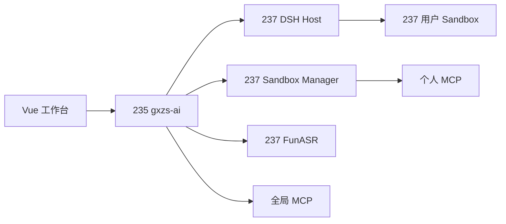

# GXZS AI 工作台架构说明

## 1. 系统概览

GXZS AI 工作台由三部分组成：

- **Vue 前端**：提供聊天、文件、技能、插件和模型配置界面；
- **Java `gxzs-ai`**：负责登录、权限、用户路由和平台能力；
- **DSH Harness**：负责AI会话、模型调用、工具执行和用户运行环境。

浏览器只访问Java服务，不直接访问DSH。



## 2. 当前部署

### 235主机

235运行业务系统：

- Vue前端；
- Java后端；
- MySQL；
- Redis。

Java公开地址：

```text
https://xcmggx.com/prod-api
```

### 237主机

237运行AI工作台基础设施：

- DSH host；
- 用户sandbox；
- sandbox-manager；
- host heartbeat；
- 内网relay；
- FunASR语音识别。

主要地址：

```text
Sandbox Manager: https://agent.xcmggx.com
Owner 1 DSH:      http://10.16.9.237:3081
Owner 2 DSH:      http://10.16.9.237:3082
FunASR:           http://10.16.9.237:8012
```

这些端口只用于235和237之间的内网通信。

## 3. 各组件负责什么

## 3.1 Vue前端

前端负责用户交互：

- 创建和管理对话；
- 发送消息和附件；
- 展示AI流式回答；
- 停止、继续和调整任务；
- 管理文件；
- 选择技能和MCP工具；
- 设置模型参数；
- 提交反馈和重新生成。

前端不保存AI服务密钥，也不知道DSH host的实际地址。

## 3.2 Java `gxzs-ai`

Java是统一业务网关，负责：

- 校验用户登录状态；
- 确定当前租户和用户；
- 查找用户对应的DSH host；
- 为请求签发内部身份断言；
- 将请求和SSE流转发给DSH；
- 管理文件分享和Office预览；
- 调用FunASR完成语音转写；
- 管理全局MCP、OAuth和加密凭据；
- 维护host状态和heartbeat。

Java不执行Agent推理，也不保存完整聊天正文。

## 3.3 DSH Host

每个用户拥有独立的DSH运行空间。DSH负责：

- 管理聊天和run；
- 调用模型；
- 调度工具；
- 保存对话事件；
- 处理SSE流；
- 执行followup、steer、stop和human input；
- 连接用户sandbox；
- 注册技能和MCP工具。

每个DSH home有独立SQLite数据库，用户之间不会共享对话存储。

## 3.4 Sandbox Manager

Sandbox Manager负责用户运行环境：

- 创建和启动sandbox；
- 管理workspace文件；
- 管理个人技能；
- 管理个人MCP；
- 生成Office预览；
- 安装受控依赖；
- 执行固定类型的运行环境操作。

Manager只提供受限接口，不允许调用方执行任意Docker命令。

## 3.5 用户Sandbox

Sandbox是用户工具运行和文件存储环境：

- `/workspace`保存用户文件；
- 用户代码和命令在sandbox中执行；
- DSH通过SSH helper访问sandbox；
- 每个workspace使用独立volume；
- 容器重建不会删除用户文件。

## 3.6 FunASR

FunASR提供语音转写：

```text
POST /v1/audio/transcriptions
model=sensevoice
```

Java限制上传大小并固定模型，前端不会直接访问FunASR。

## 4. 一次请求怎么走

### 4.1 打开工作台

```text
Vue
→ GET /ai/workbench/identity
→ Java校验登录
→ Java查询当前用户的DSH host
→ Java签发内部断言
→ DSH返回用户身份和工作台能力
```

### 4.2 发送消息

```text
Vue
→ Java
→ 当前用户的DSH host
→ 模型和工具
→ SSE事件返回Java
→ Java原样转发给Vue
```

Java不修改AI事件内容，只负责认证和转发。

### 4.3 操作文件

```text
Vue
→ Java
→ DSH
→ SSH helper
→ 用户Sandbox的/workspace
```

文件路径始终相对于用户workspace解析，不能访问宿主机其他目录。

### 4.4 使用MCP工具

个人MCP：

```text
DSH
→ Java校验用户、run和工具版本
→ Sandbox Manager
→ 用户个人MCP服务
```

全局MCP：

```text
DSH
→ Java校验用户、run和工具版本
→ Java调用管理员发布的MCP服务
```

全局MCP凭据由Java加密保存，不会发送给DSH或模型。

## 5. 数据存在哪里

| 数据 | 存储位置 |
| --- | --- |
| 用户、租户、权限 | 235 MySQL |
| Host路由和generation | 235 MySQL |
| 全局MCP配置和加密凭据 | 235 MySQL |
| 分享、OAuth state和分布式锁 | 235 Redis |
| 聊天、run和事件 | 每个用户的DSH SQLite |
| 用户文件 | 237 workspace volume |
| 个人技能和个人MCP配置 | 用户workspace |
| 临时运行进程 | 用户sandbox |

这种分布方式把平台数据、对话数据和用户文件分开管理。

## 6. 用户隔离

用户隔离由多层共同完成。

### 6.1 Java身份

Java从登录会话获取：

```text
tenantId
userId
ownerId = tenantId:userId
```

前端不能自行指定owner。

### 6.2 DSH身份断言

Java向DSH发送签名断言。断言绑定：

- owner；
- HTTP方法；
- 请求路径；
- 请求body；
- 有效时间；
- 一次性请求ID。

断言被修改、过期或重复使用时，DSH会拒绝请求。

### 6.3 固定Owner Host

每个DSH host配置固定owner。即使用户拿到另一个host的地址，也不能通过身份校验。

### 6.4 固定Workspace

每个owner绑定固定workspace UUID。文件、技能和个人MCP只能操作这个workspace。

### 6.5 Host Generation

每次重建host都会增加generation。旧host即使仍然存活，也不能继续调用平台接口或写入新的session索引。

## 7. Host状态管理

Java通过MySQL中的`gxzs_agent_host`表查找当前host。

主要字段：

```text
owner_id
generation
instance_id
endpoint
workspace_id
state
heartbeat_at
```

237上的heartbeat服务每15秒更新一次状态。

Java只会使用：

- 状态为`ready`；
- generation正确；
- instance正确；
- heartbeat未过期

的host。

Host超过45秒没有heartbeat时，Java会停止向它发送用户请求。

## 8. 对话和SSE

DSH将聊天过程保存为事件日志。前端通过SSE实时接收：

- AI文本；
- 推理状态；
- 工具调用；
- 文件活动；
- 等待用户输入；
- 完成、失败和取消事件。

SSE支持游标续传。页面断线后可以从最后一个事件继续，不需要重新执行任务。

如果一次流式回答失败，DSH会发送reset事件，前端删除这一轮已经显示但未提交的文本，避免刷新后出现残缺回答。

## 9. 文件安全

文件系统实现了以下限制：

- 拒绝绝对路径；
- 拒绝`..`路径跳转；
- 不跟随危险符号链接；
- 拒绝设备和FIFO等特殊文件；
- 写入时校验文件版本；
- 上传和下载有大小限制；
- Office预览有格式和结果大小限制。

文件删除和覆盖使用版本号，避免两个页面同时修改时互相覆盖。

## 10. 技能和插件

### 技能

技能保存在用户workspace中，可以：

- 查看；
- 导入；
- 编辑；
- 启用和禁用；
- 固定；
- 删除。

DSH通过远程技能provider读取这些内容。

### MCP插件

MCP分为：

- **个人MCP**：用户自己的配置和凭据，运行在个人sandbox侧；
- **全局MCP**：管理员发布，由Java统一管理。

每次run开始时会冻结MCP工具版本。运行过程中即使管理员修改工具配置，当前run也不会突然切换到新版本。

## 11. Office预览、分享和语音

### Office预览

Java读取用户workspace文件，调用sandbox中的LibreOffice生成PDF，再将PDF返回前端。

### 文件分享

Java生成带签名的分享链接。分享记录保存在Redis，可以设置有效期或主动撤销。

### 语音转写

Java将录音转发到237的FunASR，返回SenseVoice识别结果。

## 12. 这套架构的优点

### 用户隔离清楚

每个用户有独立DSH home、SQLite和workspace。一个用户的运行故障不会直接破坏其他用户的数据。

### 平台密钥更安全

OAuth secret、refresh token和平台主密钥只保存在Java侧。模型、DSH和sandbox拿不到长期平台凭据。

### AI内核可以独立升级

Java负责业务平台，DSH负责Agent。模型、工具和会话实现可以升级，不需要重写用户、权限和租户系统。

### 前端改动较小

Vue继续使用原来的工作台接口，DSH细节由adapter处理。

### 数据归属明确

业务数据、聊天数据、用户文件和凭据分别存放，不再混在同一个服务里。

### 故障恢复范围小

可以只重建某个owner的host或sandbox，不需要重启整个AI平台。

## 13. 当前限制

当前系统仍有几项需要继续完善：

- Host和relay数量目前较少，新增用户时仍需要创建运行实例；
- 237是单节点，故障时需要手工恢复；
- DSH home和workspace需要建立正式备份策略；
- MCP当前允许管理员发布内网地址，后续应逐步收敛访问范围；
- Vue与DSH adapter之间仍需继续补充交互测试；
- 知识库和RAG尚未接入。

## 14. 后续发展

### 第一阶段：自动编排

实现host自动创建、停止和替换：

- 用户首次访问时自动创建host；
- 自动分配workspace和relay；
- 自动更新generation；
- 自动处理heartbeat超时；
- 支持安全drain和重建。

### 第二阶段：多节点

增加更多Harness节点。调度器根据CPU、内存和当前host数量选择节点，不再依赖固定的237和固定端口。

### 第三阶段：高可用和备份

- 定期备份DSH home；
- 定期备份workspace volume；
- 增加节点故障自动迁移；
- 演练单用户恢复和整节点恢复。

### 第四阶段：监控

增加以下指标：

- 在线host数量；
- heartbeat过期数量；
- run排队和执行时间；
- SSE连接数量；
- sandbox CPU和内存；
- MCP成功率；
- FunASR耗时；
- 每个owner的错误率。

### 第五阶段：配额和策略

增加：

- 每用户并发run限制；
- 每租户总并发限制；
- workspace容量限制；
- 单次任务token和费用预算；
- MCP和技能发布审批；
- 精确的MCP出站地址列表。

### 第六阶段：知识能力

知识库需要时，由Java提供统一检索接口，包括：

- 知识资源目录；
- 检索；
- 引用；
- 文档读取；
- 租户权限；
- 审计和配额。

知识服务凭据仍然只保存在Java侧。

## 15. 总结

当前体系的职责划分很直接：

- Vue负责界面；
- Java负责用户、权限和平台服务；
- DSH负责AI会话和工具；
- Sandbox Manager负责用户运行环境；
- Sandbox负责文件和命令执行。

用户身份通过Java进入系统，每个用户被路由到自己的DSH和workspace。聊天、文件和工具相互关联，但存储和权限边界保持独立。
